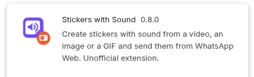

<h1 align="center">Stickers with Sound</h1>

🌐 <a href="README.md">Español</a> · <b>English</b> · <a href="README.pt.md">Português</a>

Turn a video, an image or a GIF into a <b>sticker with sound</b> and send it from <b>WhatsApp Web</b>. Everything is processed in your browser: nothing is uploaded to any server other than WhatsApp's.

 

Free and non-profit. Donations are voluntary.

> **Notice:** personal, **unofficial** project, not affiliated with WhatsApp or Meta. It uses internal WhatsApp Web features that may change at any time, and it turns on in your browser the sound sticker feature that WhatsApp is testing. Use it at your own risk (see [Disclaimer](#disclaimer)).

## Installation

There is no program to run: you load the extension folder into your browser (desktop Chrome, Edge or Brave). **It does not work in Firefox** or in browsers based on it (see [Requirements](#requirements)).

1. Download the [**ZIP of the latest version**](https://github.com/Shirtep/WA-audio-stickers/releases/latest/download/stickers-con-sonido.zip) (it is also on the [releases](https://github.com/Shirtep/WA-audio-stickers/releases/latest) page).
2. Unzip it somewhere it can stay, for example `Documents`. You will get a folder named `stickers-con-sonido`.
   **Don't delete or move it afterwards:** the browser loads the extension from there.
3. Open the extensions page: type `chrome://extensions` in the address bar (in Edge, `edge://extensions`).
4. Turn on **Developer mode** (top right):

   

5. Click **Load unpacked**:

   

6. Choose the `stickers-con-sonido` folder from step 2 and click **Select**. The extension will appear:

   

7. Click the puzzle-piece icon in the browser toolbar and pin **Stickers with Sound**, so its purple icon is always at hand.

The screenshots are from Brave. Chrome and Edge look the same, with different colors.

**Update:** download the ZIP of the new version and replace the contents of the `stickers-con-sonido` folder with the new ones. Then click the extension's reload button (↻) on the extensions page. Your settings are kept.

**Uninstall:** click **Remove** on the extensions page and delete the folder.

## Usage

1. Open [web.whatsapp.com](https://web.whatsapp.com) and go to the chat where you want to send the sticker.
2. Click the extension's purple icon. The panel has three tabs, each with its own form:
   - **Video:** a video with its own sound (steps below).
   - **Image + audio:** a still image with the sound of your choice (MP3, M4A, OGG, WAV or the sound of a video). You trim the audio with handles over its waveform, and the sticker lasts as long as that clip.
   - **Video or GIF + audio:** an animation (a video without its sound, or a GIF) with a different audio. If their durations differ, by default each keeps its own: when you tap the sticker they start together and end separately. You can also loop the animation or freeze its last frame until the audio ends. Changing the audio clip does not require recalculating the options.

   The **Video** tab has four steps:
   1. **Video:** choose a video with sound.
   2. **Clip:** drag the green handles to mark the start and the end. The video shows the exact frame, and **−/+** move one frame.
      If you only want part of the image, use **Crop**: *Free* or *1:1* (square) show a box over the video that you can move and resize from its corners. It is also available in the **Video or GIF + audio** tab when you choose a video.
   3. **Format:** click **Calculate options**. A resolution × fps table appears with the estimated size of each combination:
      - green: fits;
      - yellow: fits with lower quality;
      - ✕: does not fit;
      - ★: the recommended one.
   4. **Create & send:** optionally enter the **pack** and **author** (WhatsApp shows them below the sticker), create the sticker, check the preview and send it.
3. On your phone you can add it to your favorites to use it again.

**Language:** the panel is available in Spanish, English and Portuguese. It opens in your browser's language (in English if it is none of the three), and you can change it with **ES | EN | PT** at the top of the panel; your choice is remembered.

## Limits

| | Limit | Reason |
|---|---|---|
| Sticker size | **1 MB** | WhatsApp's server rejects larger files (error 413). |
| Audio size | 1 MB (≈ 10 min) | WhatsApp Web's limit for the sticker's audio. |
| Resolution | 64 to 512 px | WhatsApp uses 512 px. Larger doesn't look better and weighs more. |
| Smoothness | up to 30 fps | WhatsApp only requires each frame to last at least 8 ms. |

The longer the clip, the less resolution or fps fit in 1 MB: the table in step 3 shows what fits before anything is created.

Whoever receives the sticker needs a version of WhatsApp that already plays stickers with sound. Otherwise, instead of the sticker they will see a notice saying the message is not supported by their version of WhatsApp, and they will have to update WhatsApp to see it.

## Privacy

- The video conversion happens in your browser.
- The extension keeps a **diagnostic log** only in your browser, with phone numbers masked and no keys. You can view, download or delete it from *Test tools* in the panel, or by right-clicking the icon → *Options*.

## Requirements

- Up-to-date desktop Chrome, Edge or Brave (it uses WebCodecs to encode the audio). Other Chromium-based browsers, such as Opera or Vivaldi, will probably work, but they are not tested.
- A WhatsApp account open in WhatsApp Web.

**It does not work in Firefox** or in browsers based on it (LibreWolf, Waterfox, Floorp, Zen, Tor Browser…): they use a different extension system and cannot load it. It does not work in Safari or in mobile browsers either.

## Not working?

Check this before reporting it; it solves most cases:

1. **When loading it, the browser says the manifest (`manifest.json`) is missing:** you chose the wrong folder. Some unzip tools create a folder inside another one: choose the one that directly contains `manifest.json`.
2. **The extension shows an error or disappeared:** you moved or deleted the folder after installing it. Put it back where it was, or remove the extension and load it again.
3. **You click the icon and nothing happens:** reload the WhatsApp Web tab (F5). Tabs opened before installing or updating the extension don't have it.
4. **Your browser is out of date:** update it (in Chrome: menu ⋮ → Help → About Google Chrome) and try again.
5. **The recipient sees a notice saying the message is not supported by their version of WhatsApp:** the sticker was sent correctly, but their WhatsApp doesn't play stickers with sound yet. They need to update WhatsApp from their phone's app store. It is not a problem with the extension.
6. **You have an old version of the extension:** [download the latest one](https://github.com/Shirtep/WA-audio-stickers/releases/latest/download/stickers-con-sonido.zip) and update (see *Update* under installation).

If none of this solves it, your WhatsApp Web may be different: WhatsApp doesn't give everyone the same version at the same time, and the extension uses internal parts that can change. In that case, report it as explained below, with the diagnostic log.

## Report a problem or suggest something

Reports and suggestions go to [**Issues**](https://github.com/Shirtep/WA-audio-stickers/issues/new/choose). You need a GitHub account (it's free). Click **New issue** and choose:

- **Problema** (problem): something fails when installing or using it.
- **Sugerencia** (suggestion): an idea or improvement.

The forms are in Spanish, but you can write in English.

First, search the [existing issues](https://github.com/Shirtep/WA-audio-stickers/issues?q=is%3Aissue) in case someone already reported it: if so, comment there instead of opening a new one.

For a **problem**, include:

- Your browser and its version, and your system (Windows, macOS, Linux).
- The extension version (shown at the top of the panel).
- What you did, what you expected and what happened. A screenshot helps a lot; cover any chats and numbers that appear.
- **The diagnostic log**, if the problem happens while using it:
  1. Open the panel, expand **Test tools** at the bottom and click **Diagnostics**.
  2. Repeat whatever failed.
  3. Click **Save log…** and attach the `.json` file to the issue (drag it into the text box). If GitHub doesn't accept it, compress it into a ZIP.

  The log masks phone numbers and doesn't include messages or keys, but it does include the names of the files you chose and the name of the chat you sent the sticker to. Open it with a text editor and delete or change anything you don't want to share before attaching it.

If the problem is during installation, the log isn't needed: a screenshot of the error message on the extensions page is enough.

## For developers

- [`docs/como-funciona.md`](docs/como-funciona.md) (in Spanish): how a sticker with sound is built (protobuf, audio format, limits) and how the extension works.
- [`dev/`](dev/): pages to test the conversion without WhatsApp, and the sync calibration video.

## Disclaimer

This extension is a personal, free and non-profit project, and it is provided as is, without warranty.

- WhatsApp's terms of service do not authorize third-party tools like this one. WhatsApp may restrict, suspend or ban accounts that use them or that send or forward stickers made with them.
- Those decisions are made by WhatsApp alone: I don't control them and can't prevent or reverse them.
- I'm not responsible for any restriction, suspension or loss of accounts, or any other damage, resulting from using this extension or sharing the stickers it creates.

If that worries you, don't use it with an account you can't afford to lose.

## License

Free to use, **non-commercial**: you can use, study, modify and share it, but not sell it or use it for profit. Full text in [`LICENSE.md`](LICENSE.md) ([PolyForm Noncommercial 1.0.0](https://polyformproject.org/licenses/noncommercial/1.0.0)). Provided as is, without warranty.
