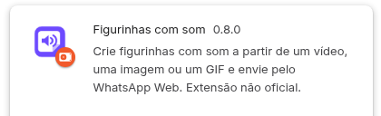

<h1 align="center">Figurinhas com som</h1>

🌐 <a href="README.md">Español</a> · <a href="README.en.md">English</a> · <b>Português</b>

Transforme um vídeo, uma imagem ou um GIF em uma <b>figurinha com som</b> e envie pelo <b>WhatsApp Web</b>. Tudo é processado no seu navegador: nada é enviado para outro servidor além do WhatsApp.

 

Gratuito e sem fins lucrativos. As doações são voluntárias.

> **Aviso:** projeto pessoal, **não oficial**, sem relação com o WhatsApp nem com a Meta. Usa funções internas do WhatsApp Web que podem mudar a qualquer momento e ativa no seu navegador a função de figurinhas com som, que o WhatsApp está testando. Use por sua conta e risco (veja [Isenção de responsabilidade](#isenção-de-responsabilidade)).

## Instalação

Não é preciso executar nenhum programa: a pasta da extensão é carregada no navegador (Chrome, Edge ou Brave para computador). **Não funciona no Firefox** nem em navegadores baseados nele (veja [Requisitos](#requisitos)).

1. Baixe o [**ZIP da versão mais recente**](https://github.com/Shirtep/WA-audio-stickers/releases/latest/download/stickers-con-sonido.zip) (ele também está na página de [versões](https://github.com/Shirtep/WA-audio-stickers/releases/latest)).
2. Descompacte em um lugar onde ele vá ficar, por exemplo `Documentos`. Você vai obter uma pasta chamada `stickers-con-sonido`.
   **Não apague nem mova a pasta depois:** o navegador carrega a extensão a partir dela.
3. Abra a página de extensões: digite `chrome://extensions` na barra de endereços (no Edge, `edge://extensions`).
4. Ative o **Modo do desenvolvedor** (no canto superior direito):

   

5. Clique em **Carregar sem compactação**:

   

6. Escolha a pasta `stickers-con-sonido` do passo 2 e clique em **Selecionar pasta**. A extensão vai aparecer:

   

7. Clique no ícone de quebra-cabeça da barra do navegador e fixe **Figurinhas com som**, para ter o ícone roxo sempre à mão.

As capturas de tela são do Brave. No Chrome e no Edge a aparência é a mesma, com outras cores.

**Atualizar:** baixe o ZIP da nova versão e substitua o conteúdo da pasta `stickers-con-sonido` pelo novo. Depois clique no botão de recarregar (↻) da extensão na página de extensões. Suas configurações são mantidas.

**Desinstalar:** clique em **Remover** na página de extensões e apague a pasta.

## Como usar

1. Abra o [web.whatsapp.com](https://web.whatsapp.com) e entre na conversa para onde você quer enviar a figurinha.
2. Clique no ícone roxo da extensão. O painel tem três abas, cada uma com o seu formulário:
   - **Vídeo:** um vídeo com o próprio som (os passos abaixo).
   - **Imagem + áudio:** uma imagem fixa com o som que você escolher (MP3, M4A, OGG, WAV ou o som de um vídeo). Você recorta o áudio com alças sobre a forma de onda, e a figurinha dura o mesmo que esse trecho.
   - **Vídeo ou GIF + áudio:** uma animação (um vídeo sem o som dele, ou um GIF) com outro áudio. Se as durações forem diferentes, por padrão cada um mantém a sua: ao tocar na figurinha, eles começam juntos e terminam separados. Você também pode repetir a animação ou congelar o último quadro até o áudio acabar. Trocar o trecho de áudio não obriga a recalcular as opções.

   A aba **Vídeo** tem quatro passos:
   1. **Vídeo:** escolha um vídeo com som.
   2. **Trecho:** arraste as alças verdes para marcar o início e o fim. O vídeo mostra o quadro exato, e **−/+** avançam ou voltam um quadro.
      Se você quiser só uma parte da imagem, use o **Recorte**: *Livre* ou *1:1* (quadrado) mostram um quadro sobre o vídeo que você pode mover e ajustar pelos cantos. Ele também está na aba **Vídeo ou GIF + áudio** quando você escolhe um vídeo.
   3. **Formato:** clique em **Calcular opções**. Aparece uma tabela de resolução × fps com o tamanho estimado de cada combinação:
      - verde: cabe;
      - amarelo: cabe com menos qualidade;
      - ✕: não cabe;
      - ★: a recomendada.
   4. **Criar e enviar:** se quiser, escreva o **pacote** e o **autor** (o WhatsApp mostra isso embaixo da figurinha), crie a figurinha, confira a prévia e envie.
3. No celular, você pode marcá-la como favorita para usar de novo.

**Idioma:** o painel está em espanhol, inglês e português. Ele abre no idioma do seu navegador (em inglês, se não for nenhum dos três), e você pode trocar com **ES | EN | PT** no alto do painel; a sua escolha fica salva.

## Limites

| | Limite | Motivo |
|---|---|---|
| Tamanho da figurinha | **1 MB** | O servidor do WhatsApp recusa arquivos maiores (erro 413). |
| Tamanho do áudio | 1 MB (≈ 10 min) | Limite do WhatsApp Web para o áudio da figurinha. |
| Resolução | 64 a 512 px | O WhatsApp usa 512 px. Maior não fica melhor e pesa mais. |
| Fluidez | até 30 fps | O WhatsApp só exige que cada quadro dure pelo menos 8 ms. |

Quanto mais longo o trecho, menos resolução ou fps cabem em 1 MB: a tabela do passo 3 mostra o que cabe antes de criar qualquer coisa.

Quem recebe a figurinha precisa de uma versão do WhatsApp que já reproduza figurinhas com som. Se não tiver, no lugar da figurinha vai ver um aviso de que a mensagem não é compatível com a versão do WhatsApp dela, e vai precisar atualizar o WhatsApp para vê-la.

## Privacidade

- A conversão do vídeo acontece no seu navegador.
- A extensão guarda um **registro de diagnóstico** só no seu navegador, com os números de telefone ocultos e sem chaves. Você pode ver, baixar ou apagar o registro em *Ferramentas de teste* no painel, ou clicando com o botão direito no ícone → *Opções*.

## Requisitos

- Chrome, Edge ou Brave para computador, atualizado (usa WebCodecs para codificar o áudio). Outros navegadores baseados no Chromium, como Opera ou Vivaldi, provavelmente funcionam, mas não foram testados.
- Uma conta do WhatsApp aberta no WhatsApp Web.

**Não funciona no Firefox** nem nos navegadores baseados nele (LibreWolf, Waterfox, Floorp, Zen, Tor Browser…): eles usam outro sistema de extensões e não conseguem carregá-la. Também não funciona no Safari nem em navegadores de celular.

## Não está funcionando?

Confira isto antes de relatar; resolve a maioria dos casos:

1. **Ao carregar, o navegador diz que falta o manifesto (`manifest.json`):** você escolheu a pasta errada. Alguns descompactadores criam uma pasta dentro de outra: escolha a que contém diretamente o `manifest.json`.
2. **A extensão aparece com erro ou sumiu:** você moveu ou apagou a pasta depois de instalar. Coloque a pasta de volta onde estava, ou remova a extensão e carregue de novo.
3. **Você clica no ícone e nada acontece:** recarregue a aba do WhatsApp Web (F5). As abas abertas antes de instalar ou atualizar a extensão não a têm.
4. **O navegador está desatualizado:** atualize (no Chrome: menu ⋮ → Ajuda → Sobre o Google Chrome) e tente de novo.
5. **Quem recebe vê um aviso de que a mensagem não é compatível com a versão do WhatsApp:** a figurinha foi enviada corretamente, mas o WhatsApp da pessoa ainda não reproduz figurinhas com som. Ela precisa atualizar o WhatsApp pela loja de aplicativos do celular. Não é um problema da extensão.
6. **Você tem uma versão antiga da extensão:** [baixe a mais recente](https://github.com/Shirtep/WA-audio-stickers/releases/latest/download/stickers-con-sonido.zip) e atualize (veja *Atualizar* na instalação).

Se nada disso resolver, pode ser que o seu WhatsApp Web seja diferente: o WhatsApp não libera a mesma versão para todos ao mesmo tempo, e a extensão usa partes internas que podem mudar. Nesse caso, relate como explicado abaixo, com o registro de diagnóstico.

## Relatar um problema ou sugerir algo

Os relatos e sugestões são recebidos em [**Issues**](https://github.com/Shirtep/WA-audio-stickers/issues/new/choose). Você precisa de uma conta no GitHub (é grátis). Clique em **New issue** e escolha:

- **Problema:** algo falha ao instalar ou ao usar.
- **Sugerencia** (sugestão): uma ideia ou melhoria.

Os formulários estão em espanhol, mas você pode escrever em português.

Antes, procure nos [issues existentes](https://github.com/Shirtep/WA-audio-stickers/issues?q=is%3Aissue) se alguém já relatou: se sim, comente lá em vez de abrir outro.

Para um **problema**, inclua:

- O seu navegador e a versão dele, e o seu sistema (Windows, macOS, Linux).
- A versão da extensão (aparece no alto do painel).
- O que você fez, o que esperava e o que aconteceu. Uma captura de tela ajuda muito; cubra as conversas e os números que aparecerem.
- **O registro de diagnóstico**, se o problema acontece ao usar:
  1. Abra o painel, expanda **Ferramentas de teste** no final e clique em **Diagnóstico**.
  2. Repita o que falhou.
  3. Clique em **Salvar registro…** e anexe o arquivo `.json` ao issue (arraste para a caixa de texto). Se o GitHub não aceitar, compacte em um ZIP.

  O registro oculta os números de telefone e não inclui mensagens nem chaves, mas inclui os nomes dos arquivos que você escolheu e o nome da conversa para onde enviou a figurinha. Abra com um editor de texto e apague ou altere o que você não quiser compartilhar antes de anexar.

Se o problema é na instalação, o registro não é necessário: basta uma captura da mensagem de erro da página de extensões.

## Para desenvolvedores

- [`docs/como-funciona.md`](docs/como-funciona.md) (em espanhol): como uma figurinha com som é montada (protobuf, formato do áudio, limites) e como a extensão funciona.
- [`dev/`](dev/): páginas para testar a conversão sem o WhatsApp e o vídeo de calibração de sincronia.

## Isenção de responsabilidade

Esta extensão é um projeto pessoal, gratuito e sem fins lucrativos, e é fornecida como está, sem garantias.

- Os termos de serviço do WhatsApp não autorizam ferramentas de terceiros como esta. O WhatsApp pode restringir, suspender ou banir contas que as usem ou que enviem ou encaminhem figurinhas criadas com elas.
- Essas decisões são tomadas só pelo WhatsApp: eu não as controlo e não posso evitá-las nem revertê-las.
- Não me responsabilizo por nenhuma restrição, suspensão ou perda de contas, nem por outros danos, resultantes do uso desta extensão ou do compartilhamento das figurinhas que ela cria.

Se isso preocupa você, não use a extensão com uma conta que você não pode perder.

## Licença

Uso livre e gratuito, **sem fins comerciais**: você pode usar, estudar, modificar e compartilhar, mas não vender nem usar para lucrar. Texto completo em [`LICENSE.md`](LICENSE.md) ([PolyForm Noncommercial 1.0.0](https://polyformproject.org/licenses/noncommercial/1.0.0)). Fornecida como está, sem garantias.
